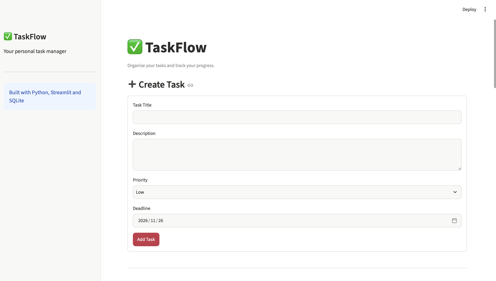
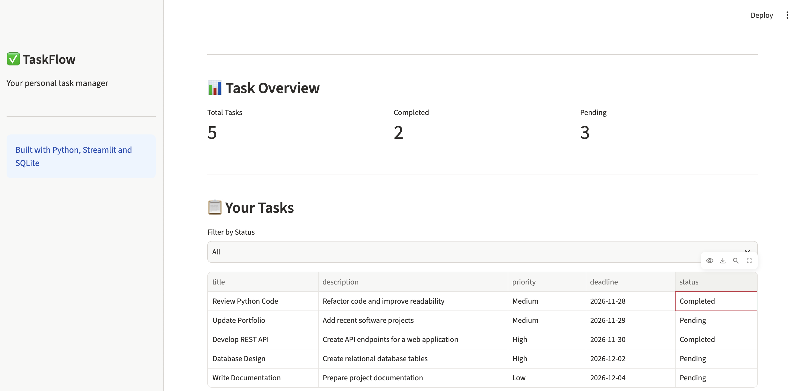
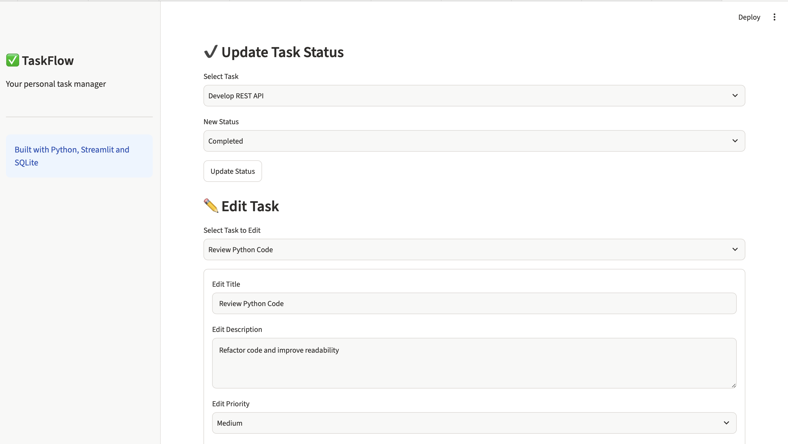
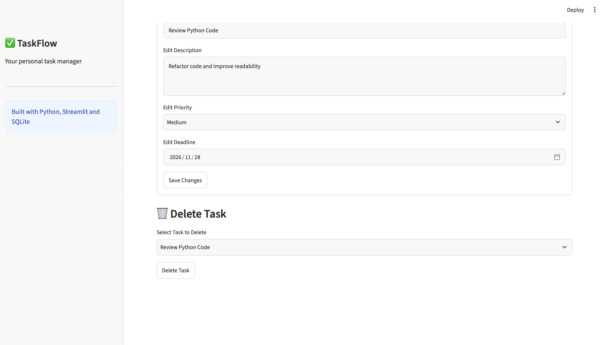

# TaskFlow

## Overview

TaskFlow is a Python-based task management application designed to help users organise tasks, manage deadlines and track productivity.

## Features

- Create and manage tasks
- Add task descriptions
- Assign priority levels
- Set task deadlines
- Edit existing tasks
- Mark tasks as completed
- Filter tasks by status
- Delete tasks
- View task statistics
- Persistent local data storage

## Technologies Used

- Python
- Streamlit
- Pandas
- SQLite

## Installation

Clone the repository and install the dependencies:

    pip install -r requirements.txt

Run the application:

    streamlit run app.py

## Project Status

Working prototype using a local SQLite database.
Further testing and improvements are planned.

## Author

Samuel Sodipo
Computer Science Student
Northumbria University

## Application Screenshots

### Create a Task

### Task Management Dashboard

### Update and Edit Tasks

### Manage and Delete Tasks

